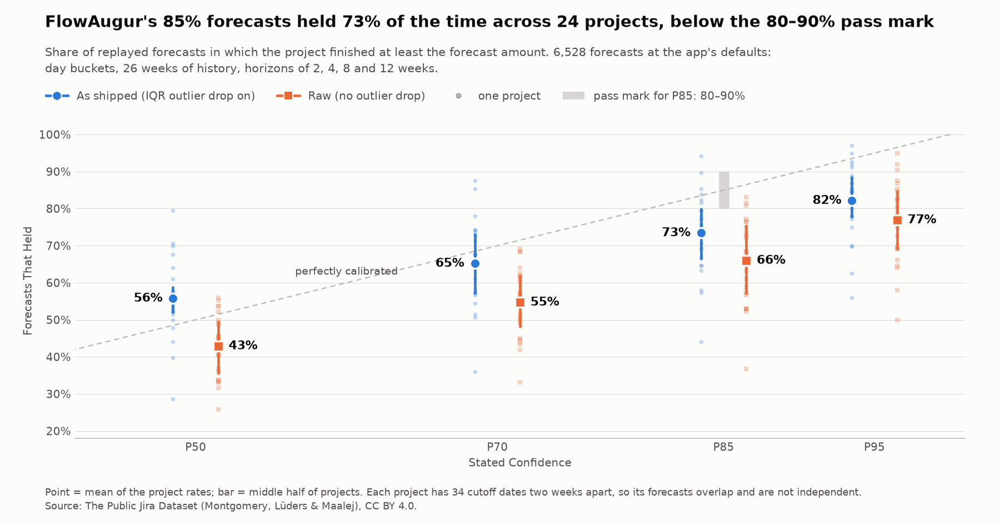
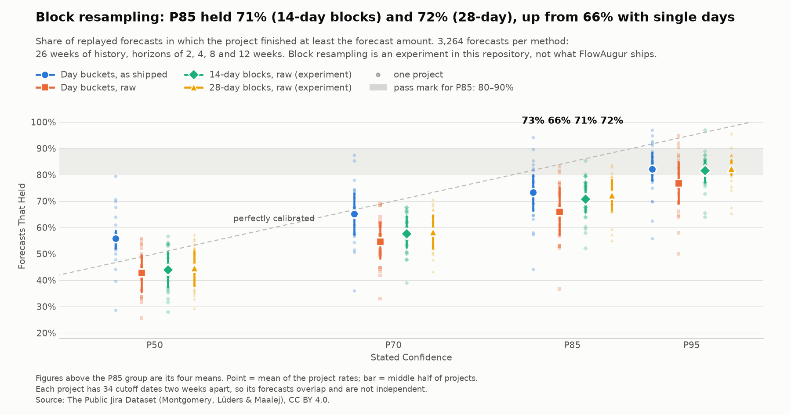

# FlowAugur backtest

When a throughput Monte Carlo forecast says "85% likely", does the work land in
time about 85% of the time? This repository replays
[FlowAugur](https://flowaugur.com) forecasts on real, public Jira history and
scores each one against what actually happened.

- **Real history:** 24 steady projects from 10 public Jira instances, taken
  from The Public Jira Dataset.
- **The app's own code:** the forecasts come from a verbatim copy of the
  functions FlowAugur runs in production, not a re-implementation.
- **No hindsight:** each forecast is rebuilt from the data before its cutoff
  date only, then compared with the following 2 to 12 weeks.

## Results so far

39,168 replayed forecasts: 24 projects, 34 cutoff dates each, two weeks apart.
At the app's default settings (day buckets, 26 weeks of history):

| | P50 | P70 | P85 | P95 |
|---|---:|---:|---:|---:|
| As shipped (IQR outlier drop on) | 56% | 65% | 73% | 82% |
| Raw (no outlier drop) | 43% | 55% | 66% | 77% |

Each figure is the share of forecasts in which the project finished at least
the forecast amount. A calibrated P85 would hold 85% of the time; the pass mark
set beforehand was 80–90%. **FlowAugur's 85% forecasts held 73% of the time**,
so on this data the forecast is overconfident.



- **The forecast range is too narrow.** 56% of actual results fell in the
  outer tenths of their forecast distribution, where a calibrated forecast
  would put 20% ([PIT histogram](figures/pit_histogram.png)).
- **The outlier drop makes the forecast more cautious, not more accurate.** It
  removes the busiest days from history, which lowers the forecast by a median
  8%. A lower forecast is easier to beat, so more of them hold (73% against
  66%), but the continuous score barely moves (mean CRPS 64 against 65) and the
  range is too narrow either way.
- **Wider buckets held more often**, by a few points: P85 held 73% with day
  buckets, 76% with week and 79% with 2-week
  ([bucket comparison](figures/bucket_comparison.png)).
- **Longer horizons held less often**: as shipped, P85 held 78% at 2 weeks and
  70% at 12 weeks.
- **Projects differ a lot**: P85 coverage runs from 44% (Apache AMBARI) to 94%
  (Spring SPR); 5 of the 24 projects sit inside the 80–90% pass mark.

Limits to keep in mind:

- All 24 projects are steady by FlowAugur's own cadence detection, so these
  results say nothing about teams that close work in batches.
- They are open-source projects, mostly closing bugs, and "done" includes
  tickets closed as Duplicate or Invalid.
- A project's 34 cutoffs overlap, so its forecasts are not independent.
- Seven of the 24 two-year windows fall in 2020–2021.
- The forecast is of items completed. It does not model scope added later.

## Experiment 3b: does block resampling fix the narrow range?

**No.** This is experiment code written for this backtest (`experiment_3b.py`),
not FlowAugur's engine and not in the app.

FlowAugur resamples single days independently. The experiment resamples runs of
14 or 28 consecutive real days instead (a moving-block bootstrap), on raw
history with 26 weeks of history and the same forecasts as above. The pass
test was fixed before any results: P85 holds 80–90%, at most 30% of results in
the outer tenths, and mean CRPS at most 64.

| | P85 held | Results in outer tenths | Mean CRPS | Passes |
|---|---:|---:|---:|---|
| Day buckets, as shipped (Session 3) | 73% | 56% | 63.9 | no |
| Day buckets, raw (Session 3) | 66% | 50% | 65.0 | no |
| 14-day blocks, raw (experiment) | 71% | 43% | 63.9 | no |
| 28-day blocks, raw (experiment) | 72% | 42% | 64.6 | no |

Block resampling moves every measure the right way and closes a third to a
half of the gap to the pass marks for coverage and for the tails. Neither block
length passes.



Why resampling the past cannot close the gap: **teams change pace more than
their own history suggests.** For each forecast, divide the horizon's daily
rate by the daily rate of the 26 weeks before it, and call a result below 0.8
or above 1.25 a pace shift. The table sets how often that happened against how
often each method's own simulated outcomes expected it.

| Horizon | Pace shifted | Expected by single days | by 14-day blocks | by 28-day blocks |
|---|---:|---:|---:|---:|
| 2 weeks | 57% | 40% | 49% | 49% |
| 4 weeks | 52% | 26% | 35% | 40% |
| 8 weeks | 46% | 14% | 22% | 25% |
| 12 weeks | 47% | 9% | 15% | 18% |

Over 12 weeks the pace shifted in 47% of forecasts. Resampling single days
expected that 9% of the time, and block resampling 15% to 18%. Blocks close
about a sixth to a quarter of that gap and leave the rest. At 2 weeks chance
swings dominate; the 8- and 12-week rows are the ones to read. A forecast
built only from how fast the team went recently is confident about a pace
that often does not hold.

## The engine

FlowAugur's app lives in a private repository, MonteJiraSim. `engine/` holds a
verbatim copy of just the definitions this backtest calls
(`forecast_items_by_date`, `confidence_amounts`, `bucket_daily_series`,
`remove_outliers_iqr`, `detect_cadence` and the constants they use), taken at
MonteJiraSim commit `ae17e093878c68057ee8f5f3e7e54d8fc325305a`.

```bash
uv run python engine/snapshot.py                            # definitions match the pinned hashes
uv run python engine/snapshot.py --source ../MonteJiraSim   # and match that commit, byte for byte
```

The first check needs only this repository and runs in the test suite. The
second needs a MonteJiraSim checkout, so only the maintainer can run it.

## Data

**The Public Jira Dataset** — Montgomery, Lüders and Maalej (University of
Hamburg): 16 public Jira instances downloaded through the Jira API in January
2022, personal names replaced with UUIDs. Licensed **CC BY 4.0**.

- Zenodo record [15719919](https://zenodo.org/records/15719919) (published
  2025-06-23; concept DOI [10.5281/zenodo.5882881](https://zenodo.org/doi/10.5281/zenodo.5882881))
- `2025-06-23 ThePublicJiraDataset.zip`, 5,813,135,238 bytes,
  md5 `02f85309d966092ea130ca0797aea795`
- Cite as: Montgomery L, Lüders C, Maalej W. *An Alternative Issue Tracking
  Dataset of Public Jira Repositories.* MSR 2022, pp. 73–77.
  ([arXiv:2201.08368](https://arxiv.org/abs/2201.08368))

## Rebuild the extract

No MongoDB needed: the script reads the `mongodump` archive inside the ZIP
directly (about 3.5 minutes, 56 GB of BSON streamed, constant memory).

```bash
curl -L -o ThePublicJiraDataset.zip \
  "https://zenodo.org/api/records/15719919/files/2025-06-23%20ThePublicJiraDataset.zip/content"
md5sum ThePublicJiraDataset.zip          # 02f85309d966092ea130ca0797aea795

uv run --group extract extract_done_dates.py ThePublicJiraDataset.zip   # -> data/
uv run throughput_overview.py                                           # -> daily export, overview, sparklines
uv run --group extract extract_done_dates.py --derive-only              # re-derive done dates, no ZIP
```

Everything after the extract runs from `data/daily_throughput.parquet`, which
is committed, so the download is only needed to rebuild from scratch.
[uv](https://docs.astral.sh/uv/) installs the dependencies from `uv.lock`.

## Run the backtest

`replay.py` rebuilds FlowAugur's forecast at each cutoff from the data before
it, using the engine snapshot unchanged, and scores it against what happened.
`backtest.py` runs it for the 24 projects, after checking that each project's
window and cutoffs still match `data/frozen_windows.csv`, the table fixed
before any results existed.

```bash
uv run backtest.py                                      # -> data/results.parquet (about 90 seconds)
uv run experiment_3b.py                                 # -> data/experiment_3b.parquet (block resampling, 10 seconds)
uv run charts.py                                        # -> figures/calibration, bucket_comparison, pit_histogram (+ the _3b pair)
uv run fan_chart.py --instance Apache --project SPARK   # -> figures/fan_apache_spark.png
uv run replay.py --instance Apache --project SPARK      # one project on its own
uv run pytest                                           # replay wiring, the gate, engine snapshot
```

The projects are the five largest per Jira instance among those with a
two-year window in which at least 10 items were done in at least 90% of weeks.
Cutoffs run every two weeks inside that window. A forecast made at a cutoff
uses the 12 or 26 weeks before it and is scored on the 2, 4, 8 or 12 weeks
after it.

`results.parquet` has one row per project × cutoff × bucket (day, week,
2 weeks) × history (84, 182 days) × horizon (14, 28, 56, 84 days) × outlier
drop (on, off):

| Column | Meaning |
|---|---|
| `p50`, `p70`, `p85`, `p95` | The engine's "at least this many items" amount at each confidence level |
| `hit_p50` … `hit_p95` | Whether the actual count met that amount (the app's own scoring rule) |
| `actual` | Items really done in the horizon |
| `mean`, `naive` | Mean of the simulated totals; history average per day × horizon |
| `pit` | Share of simulated totals at or below the actual |
| `crps` | Continuous ranked probability score of the forecast; lower is better |
| `n_samples`, `days_dropped` | Buckets fed to the engine; days removed by the IQR outlier drop |

The conventions (which days are history, which window the cutoffs come from)
are in the docstring of `replay.py`. The chart definitions are in the docstring
of `charts.py`.

## What's in `data/`

| File | Rows | Size | What |
|---|---:|---:|---|
| `done_dates.parquet` | 2,686,223 | 66 MB | One row per issue, done or not (git-ignored) |
| `status_transitions.parquet` | 5,676,383 | 49 MB | Every changelog status change (git-ignored) |
| `daily_throughput.parquet` | 603,503 | 1.2 MB | Done items per instance / project / issue type / UTC day |
| `project_overview.csv` | 1,227 | 75 KB | Per-project span and steadiness metrics (project-filter inputs) |
| `status_categories.csv` | 756 | 40 KB | The status → category map used, and how each was inferred |
| `instance_summary.csv` | 16 | 1 KB | Counts and date span per Jira instance |
| `frozen_windows.csv` | 24 | 2 KB | The 24 projects with their window and first and last cutoff, fixed before the run |
| `results.parquet` | 39,168 | 1.1 MB | Every scored forecast: the results table |
| `project_summary.csv` | 24 | 3 KB | Per project: window, detected cadence, and how often each band held |
| `experiment_3b.parquet` | 13,056 | 0.4 MB | Experiment 3b: the two block-resampling variants and the two Session 3 baselines, scored, with each forecast's pace ratio and expected shift share |
| `experiment_3b_summary.csv` | 4 | 1 KB | Experiment 3b: each method against the pass test |
| `experiment_3b_pace.csv` | 12 | 1 KB | Experiment 3b: observed, expected and excess pace-shift share by horizon and method |
| `experiment_3b_pace_distribution.csv` | 5 | 1 KB | Experiment 3b: the pace ratio's quantiles, overall and by horizon |

In `figures/`:

| File | What |
|---|---|
| `calibration.png` | Stated confidence against how often it held, across projects |
| `bucket_comparison.png` | P85 coverage for day, week and 2-week buckets |
| `pit_histogram.png` | Where actual results fell inside their forecast distributions |
| `calibration_3b.png`, `pit_histogram_3b.png` | The same two charts with the block-resampling experiment added |
| `fan_apache_spark.png` | One Apache SPARK forecast against what happened |
| `weekly_throughput.png` | Weekly throughput for 119 candidate projects, used to choose the filter |

### `done_dates.parquet`

| Column | Meaning |
|---|---|
| `instance`, `project`, `key`, `issue_id` | Jira instance (one of 16), project key, issue key, numeric id |
| `issue_type`, `is_subtask` | Issue type name and Jira's sub-task flag |
| `status`, `status_id`, `status_category` | Status at download time; category is `new` / `indeterminate` / `done` |
| `resolution` | Resolution name (Fixed, Duplicate, Won't Fix, …), null if unresolved |
| `created`, `resolutiondate` | Straight from Jira, converted to UTC |
| `first_done` | First changelog transition into a Done-category status from outside it |
| `last_done` | Last such entry (differs from `first_done` when reopened) |
| `done_entries` | Number of entries into Done; more than 1 means reopened |
| `done_date` | **The backtest's done date**: `first_done`, else `resolutiondate` |
| `done_source` | `changelog`, `resolutiondate` (no changelog) or `resolutiondate_no_entry` |
| `n_histories`, `n_status_changes`, `changelog_truncated` | Changelog size; truncated = Jira returned fewer entries than it reported |

All timestamps are UTC at second precision.

## Done-date rule

The first changelog transition that takes the issue into a Done-category status
from outside that category; if the changelog shows no such entry, the
resolution date. Of 2,329,617 issues with a done date, 97.7% come from the
changelog, 2.2% from the resolution date because the changelog has no entry
into Done, and 0.1% from the resolution date because there is no changelog.

Two points go beyond that one-line rule:

- **Moves between Done statuses are not entries.** About 32,000 issues first appear
  in a Done status through a move such as Resolved → Closed, because the
  changelog has lost the original resolve; the move is typically a bulk
  migration years later (median gap 3.9 years). Counting it would date, for
  example, 3,917 Confluence Cloud issues to 22 August 2019. Those issues use
  the resolution date instead.
- **Categories are inferred.** Changelogs carry status names and ids, not
  categories. A status takes the category of the issues currently in it (97.6%
  of status changes). For statuses nobody holds any more: the same name in the
  same instance, then Jira's built-in ids (5 Resolved and 6 Closed are Done),
  then "at least 80% of transitions into it set a resolution". The remaining
  2.0% of status changes go to statuses of unknown category, which never count
  as Done. `status_categories.csv` lists every status and its source.

To get the literal reading instead (any transition into a Done status):

```python
t = pd.read_parquet("data/status_transitions.parquet")
# join status_categories.csv on (instance, to_id) and take min(at) where category == "done"
```

## Things to know before using it

- **The data ends in January 2022** (MariaDB January 2021, Mindville April
  2021). `instance_summary.csv` has the last activity date per instance.
- **1,276 projects hold issues.** The dataset's headline 1,822 also counts
  projects that issues were moved out of.
- **"Done" includes non-delivery closures.** Among counted done items 41% are
  Fixed and 15% Done, but 15% are Duplicate and 7% Invalid. Mojang is a public
  bug-report queue: 47% Duplicate, 22% Invalid, 5% Fixed.
- **Three quarters of counted items are Bugs** (1.36M of 1.84M); Story is 30K.
  New Feature (65K done) and Suggestion (113K) are outside the four counted types.
- **Bulk events are real and visible**: imports and mass closes put thousands
  of items on one day (Apache FLEX, 25–29 January 2012: about 30,000).
- **First done, not last.** 9.1% of done issues were reopened. Production
  FlowAugur reads Jira's `resolutiondate`, which is the *last* resolve; it is
  more than a day later than `done_date` for 7.0% of issues.
- **A few impossible dates are kept as they are**: 290 issues were created
  before 2000 (Apache SPARK has year 0012), and 24 are done before they were
  created. Converting `created` to nanosecond timestamps will overflow.
- 59 issues appear twice in the dump as identical copies; the extract keeps one.

## License and credit

The code is under the [MIT License](LICENSE).

The files in `data/` and `figures/` are derived from **The Public Jira
Dataset** by Lloyd Montgomery, Clara Lüders and Walid Maalej (University of
Hamburg), which is licensed
[CC BY 4.0](https://creativecommons.org/licenses/by/4.0/). They are shared
under the same licence. Changes made: done dates were derived per issue from
the changelogs, and issues were counted per project and day.
