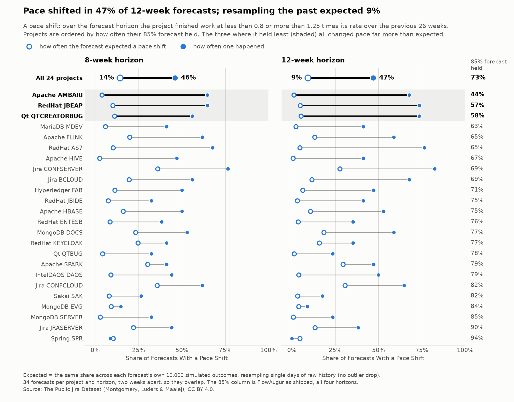

# FlowAugur backtest

When a throughput Monte Carlo forecast says "85% confident", does the work
land about 85% of the time? This repository replays
[FlowAugur](https://flowaugur.com)'s forecasts on real, public Jira history and
scores each one against what actually happened.

**Result: FlowAugur's 85% forecasts held 73% of the time.** The pass mark set
beforehand was 80–90%, so on this data the forecast is overconfident.

The write-up is at <https://flowaugur.com/backtest/>. How it was done is in
[METHODS.md](METHODS.md).

## What was tested

- **Real history.** 24 steady projects from 10 public Jira instances, taken
  from The Public Jira Dataset.
- **No hindsight.** Each forecast is rebuilt as if made on a past date, from
  the 26 weeks before that date only, then scored on the following 2, 4, 8 or
  12 weeks. There are 34 such dates per project, two weeks apart.
- **The app's own code.** The forecasts come from FlowAugur's forecasting
  functions, not a re-implementation.

That gives 39,168 scored forecasts across every variant, and 6,528 at the
app's default settings.

## What it found

Share of forecasts in which the project finished at least the forecast amount,
at the app's defaults:

| | P50 | P70 | P85 | P95 |
|---|---:|---:|---:|---:|
| As shipped | 56% | 65% | 73% | 82% |
| Without the app's outlier drop | 43% | 55% | 66% | 77% |


- **The forecast range is too narrow.** 56% of actual results fell in the
  outer tenths of their own forecast distribution. A calibrated forecast puts
  20% there.
- **The cause is teams changing pace.** Over 12 weeks, a project's pace moved
  below 0.8 or above 1.25 times its pace over the previous 26 weeks in 47% of
  forecasts. Resampling the past expected that 9% of the time. The projects
  where the forecast held least are the ones whose pace shifted most.
- **A partial fix was tried and did not pass.** Resampling runs of 14 or 28
  consecutive days instead of single days (experiment code in this repository,
  not part of FlowAugur) raised P85 coverage from 66% to 71–72% and closed a
  third to a half of the gap. It failed the test declared for it beforehand.
- **The app's outlier drop makes the forecast more cautious, not more
  accurate.** It lowers the forecast, so more forecasts hold (73% against
  66%), while the continuous score barely moves.



## Limits

- All 24 projects are steady, continuous-flow projects by FlowAugur's own
  cadence detection. Nothing here covers teams that close work in batches.
- They are open-source projects, mostly closing bugs, and "done" includes
  tickets closed as Duplicate or Invalid.
- A project's 34 forecasts overlap, so they are not independent.
- Seven of the 24 two-year windows fall in 2020–2021, so those years carry
  extra weight.
- The forecast is of items completed. It does not model scope added later.

[METHODS.md](METHODS.md) has the full results, the decisions and when they
were made, what was checked, and the data caveats.

## Run it again

You need [uv](https://docs.astral.sh/uv/); it installs everything from
`uv.lock`.

```bash
uv run pytest               # the test suite
uv run backtest.py          # every forecast  -> data/results.parquet   (about 90 seconds)
uv run experiment_3b.py     # block resampling -> data/experiment_3b.parquet
uv run charts.py            # -> figures/
uv run fan_chart.py --instance Apache --project SPARK
```

These run from `data/daily_throughput.parquet`, which is in the repository. To
rebuild that file from the original dataset (a 5.8 GB download; no MongoDB
needed):

```bash
curl -L -o ThePublicJiraDataset.zip \
  "https://zenodo.org/api/records/15719919/files/2025-06-23%20ThePublicJiraDataset.zip/content"
md5sum ThePublicJiraDataset.zip      # 02f85309d966092ea130ca0797aea795

uv run --group extract extract_done_dates.py ThePublicJiraDataset.zip
uv run throughput_overview.py
```

## The engine

The forecasting code in `engine/` is a verbatim copy of FlowAugur's, pinned to
a commit in its private repository and verified here by hashes, so its match
to the shipped app rests on the author's word.

`uv run python engine/snapshot.py` runs the hash check.

## Data and credit

The data is **The Public Jira Dataset** by Lloyd Montgomery, Clara Lüders and
Walid Maalej (University of Hamburg), licensed
[CC BY 4.0](https://creativecommons.org/licenses/by/4.0/).

- Zenodo: [10.5281/zenodo.5882881](https://zenodo.org/doi/10.5281/zenodo.5882881)
  (this backtest uses record [15719919](https://zenodo.org/records/15719919))
- Montgomery L, Lüders C, Maalej W. *An Alternative Issue Tracking Dataset of
  Public Jira Repositories.* MSR 2022, pp. 73–77.
  [arXiv:2201.08368](https://arxiv.org/abs/2201.08368)

The files in `data/` and `figures/` are derived from that dataset and are
shared under the same licence. Changes made: done dates were derived per issue
from the changelogs, issues were counted per project and day, and forecasts
were replayed and scored on those counts.

## License

The code is under the [MIT License](LICENSE). Written by Dan Parker, Parker
Studio.
